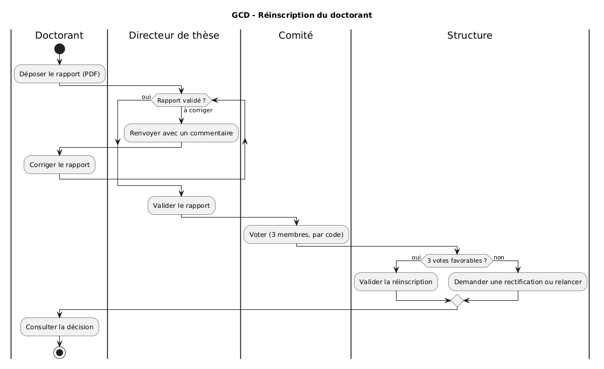

## Diagrammes d'inscription et de réinscription

### Inscription avec GCD

### Inscription sans GCD

### Réinscription avec GCD

### Réinscription sans GCD

## Catalogue des sujet

## Espace mon dossier candidat

## Espace directeur de these 

  ## Page Commission/ directeur these
  
  ## Page Proposition des sujets
  
## Espace directeur structure

## Tableaux d'exception

## Validation sujets et modification de la date des candidatures

